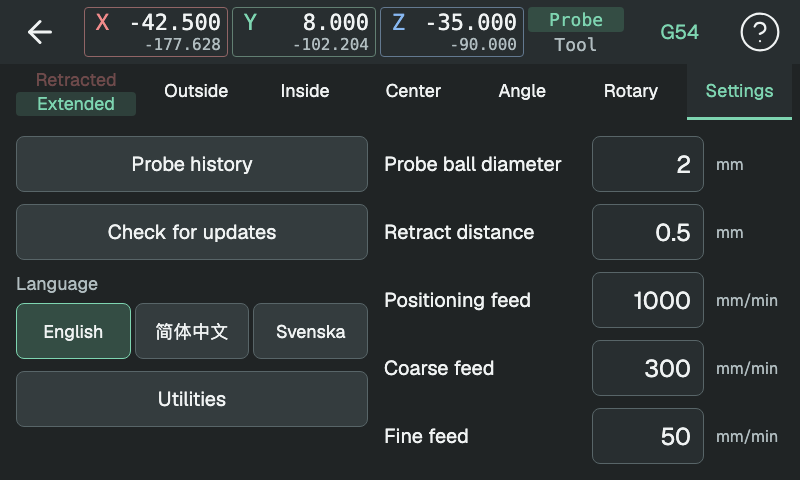

# Settings

Settings are saved when you accept a value and survive restarts. Distances use mm; linear feeds use mm/min.

<!-- guide-only -->

<!-- /guide-only -->

## Ball diameter

The ball touches a surface before the probe's electrical contacts switch.
During that small extra movement, the stylus deflects and the mechanism inside
the probe moves. **Probe ball diameter** accounts for this by storing an
effective diameter smaller than the physical ball. PIMProbe uses it to calculate
wall positions and widths from the recorded touches.

Follow [Calibrate the probe](calibration.md) to calculate and save this value
from a known size. The default 1.83 mm is a starting point, not a calibration.

## Backoff

**Retract distance** is how far the probe backs away after each touch. It must
be enough for the probe to release before the next touch.

## Feeds

- **Coarse feed:** the first search for a surface.
- **Fine feed:** the speed of the second touch, which supplies the measurement.
- **Positioning feed:** travel between touches and backoff moves.
- **Rotary feed:** A rotation in degrees/min.

## Language

Choose English, Simplified Chinese or Swedish. Until you choose, the interface uses the CNC screen's language, or the computer's language in a local preview.

## Updates

**Check for updates** opens the release notes and installer. **Development releases** selects the rolling build instead of stable releases; that choice stays selected after installation.

**Check automatically** checks the selected channel each time the interface opens. A green dot on Settings and the update button means a new version is available. Installing it restarts the interface.

## Utilities

**Probe history** reopens saved measurements. **Export logs** copies history and diagnostic logs to a mounted USB drive. **Clear logs** deletes them after confirmation.

**Probe repeatability** measures the L bracket walls and bed repeatedly to compare readings, with optional probe retraction and homing between runs.

<!-- guide-only -->
[History and logs](history.md)

[Repeatability check](repeatability.md)

[Editing numbers](editing.md)
<!-- /guide-only -->
