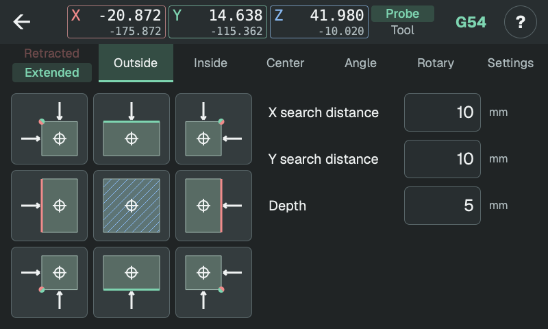
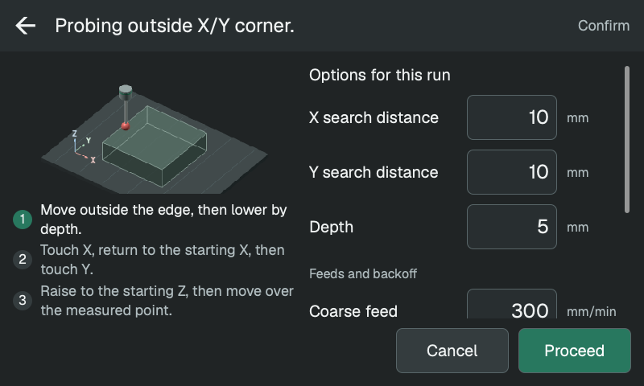

# Guide för probning

Börja med [Kalibrera proben](calibration.md) innan du använder proben för att
sätta arbetsnollpunkter.

Välj en mätning:

- [Utvändigt](outside.md): ämnets kant, ett utvändigt hörn eller ovansidan.
- [Invändigt](inside.md): en fickvägg, ett invändigt hörn eller en bottenyta.
- [Centrum](center.md): centrum på en tapp, ett block, ett hål, en ficka, en ribba eller ett spår.
- [Vinkel](angle.md): ytvinkel i X/Y eller Z-lutning längs X eller Y.
- [Rundaxel](rotary.md): rundaxelns centrum eller en ytas vinkel.

Korset markerar **probkulans** startläge. Vita pilar visar rörelser; kryssade cirklar visar probning nedåt i en vy ovanifrån.

Referenser använder axelfärgerna: **X röd, Y grön, Z blå**. En punkt visar en möjlig nollpunkt, en linje eller skrafferad yta visar ett nollplan och en vinklad linje visar den uppmätta riktningen. Markeringarna visar vad du kan ställa in från resultatet; enbart mätningen ändrar inte arbetskoordinatsystemet.

<!-- guide-only -->

<!-- /guide-only -->

## Starta en mätning

Välj en bild för att öppna bekräftelseskärmen. Den visar rörelsevägen. Jämför vägen med ämnet och spännjärnen; kontrollera även probskaftets frigång.

Här kan du ändra avstånd och matningar enbart för denna körning. **Fortsätt** startar från kulans position när du trycker, så du kan fortfarande köra manuellt före start. **Avbryt** återgår utan rörelse.

<!-- guide-only -->

<!-- /guide-only -->

Proben probar varje yta två gånger: grovsökning, tillbakagång och sedan en långsammare finprobning. Finprobningen ger mätvärdet.

[Resultat och arbetsnollpunkt](results.md)

## Koordinater och reglage

- De stora koordinaterna visas i valt arbetskoordinatsystem; de små i maskinkoordinater, G53.
- Välj **Prob** för probkulan eller **Verktyg** för verktygsspetsen. Prob
  använder sin egen kalibrering; Verktyg använder maskinens aktiva
  verktygslängdskompensation.
- **G54–G59** väljer arbetskoordinatsystem. Varje system sparar sin egen nollpunkt.

Kanter, hörn och centrum följer de valda arbetskoordinataxlarna, även när de
är roterade i X/Y. Vinkel- och rundaxelmätningar följer maskinaxlarna.

- Tryck på **Infälld / Utfälld** bredvid flikarna för att fälla ut eller in proben oberoende av mätningarna. Den markerade raden visar aktuellt läge.
- **?** markerar reglagen. Tryck på ett för en förklaring, eller på **Handbok** för de här sidorna. **×** lämnar hjälpen.

## Kontakt och fel

Positioneringsrörelser i sidled och nedåt stannar när kulan får kontakt. Manuell körning och vanliga uppåtrörelser gör det inte. En kollision med skaftet kan ske utan att kulan löser ut.

Om proben inte hittar ytan stoppas mätningen med ett felmeddelande. Ett larm
kan behöva kvitteras i maskinens reglage innan du försöker igen. Kontrollera
att kulan kan nå den avsedda ytan i vald riktning inom söksträckan.

## Övriga sidor

- [Inställningar](settings.md): kuldiameter, tillbakagång, matningar och uppdateringar.
- [Redigera tal](editing.md)
- [Historik och loggar](history.md)
