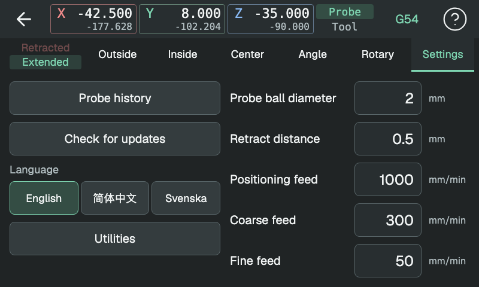

# Inställningar

Inställningarna sparas när du godkänner ett värde och finns kvar efter omstart. Avstånd anges i mm; linjära matningar i mm/min.

<!-- guide-only -->

<!-- /guide-only -->

## Kuldiameter

Kulan rör vid ytan innan probens elektriska kontakter slår om. Under den
extra rörelsen böjs mätspetsen och mekanismen inuti proben rör sig.
**Probkulans diameter** tar hänsyn till detta genom en effektiv diameter
som är mindre än den fysiska. PIMProbe använder den för att beräkna
väggarnas lägen och måtten mellan dem från de registrerade kontakterna.

Följ [Kalibrera proben](calibration.md) för att beräkna och spara värdet från
ett känt mått. Standardvärdet 1.83 mm är en utgångspunkt, inte en kalibrering.

## Tillbakagång

**Tillbakagång** är sträckan som proben backar efter varje kontakt. Den måste
räcka för att probkontakten ska släppa före nästa beröring.

## Matningar

- **Grovmatning:** den första sökningen efter en yta.
- **Finmatning:** hastigheten vid den andra kontakten, som ger mätvärdet.
- **Matning vid flytt:** förflyttningar mellan kontakter och tillbakagång.
- **Rundaxelmatning:** rotation av A i grader/min.

## Språk

Välj engelska, förenklad kinesiska eller svenska. Tills du väljer används CNC-skärmens språk, eller datorns språk i en lokal förhandsvisning.

## Uppdateringar

**Sök uppdateringar** öppnar versionsinformationen och installationsprogrammet. **Utvecklingsversioner** väljer den löpande utvecklingsversionen i stället för stabila versioner; valet finns kvar efter installation.

**Sök automatiskt** kontrollerar den valda kanalen varje gång gränssnittet öppnas. En grön punkt på Inställningar och uppdateringsknappen betyder att en ny version finns. Installationen startar om gränssnittet.

## Probhistorik

**Probhistorik** öppnar sparade mätningar och kalibreringar.

## Hjälpfunktioner

**Exportera loggar** kopierar historik och diagnostikloggar till ett monterat USB-minne. **Rensa loggar** tar bort dem efter bekräftelse.

<!-- guide-only -->
[Historik och loggar](history.md)

[Redigera tal](editing.md)
<!-- /guide-only -->
